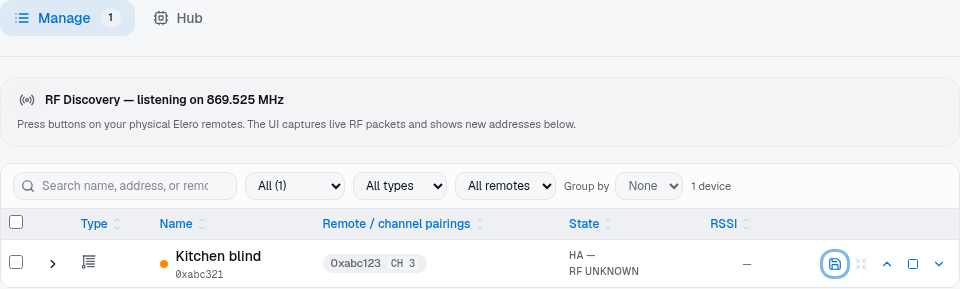
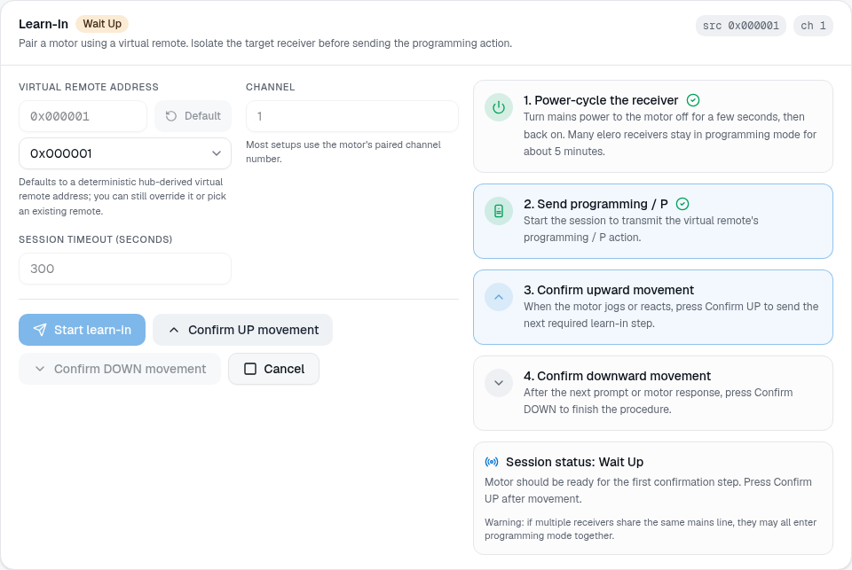

# esphome-elero

Control your Elero blinds and lights from Home Assistant. An ESP32 board acts as the gateway. It can pair with the motor as a new remote or listen to a remote you already use.

## Quick start

### 1. Choose an 868 MHz board

**We recommend the Heltec WiFi LoRa 32 V3 or V4.** Budget about US$30. Choose **863–870 MHz** in the band selector. The SX1262 radio is built in. Use an 868 MHz antenna and a USB-C data cable. [Heltec V3 models and prices](https://heltec.org/project/wifi-lora-32-v3) · [Heltec V4 models and prices](https://heltec.org/project/wifi-lora-32-v4)

**If you prefer LILYGO,** choose the **T-Embed CC1101** or **T-Embed CC1101 Plus**. Both have a built-in CC1101 radio that can operate at 868 MHz. [T-Embed CC1101 radio bands](https://lilygo.cc/en-us/products/t-embed-cc1101) · [Plus model description](https://lilygo.cc/products/t-embed-cc1101-plus)

**Avoid CC1101 boards and modules sold for 433 MHz.** They have poor range with 868 MHz Elero equipment. [Installation guide, required parts](docs/INSTALLATION.md#1-required-parts)

| Board | ESPHome starter file | What to check |
|---|---|---|
| Heltec WiFi LoRa 32 V3 | [Heltec V3 YAML](configs/quickstart/heltec-v3.yaml) | Choose the 868 MHz version. |
| Heltec WiFi LoRa 32 V4 | [Heltec V4 YAML](configs/quickstart/heltec-v4.yaml) | Read the revision on the board. The file uses `GPIO46` for V4.2. For V4.3.1 and later, use `GPIO5` for `fem_pa_pin`. This setting still needs a hardware test. [V4 revision guide](docs/devices/heltec-lora-v4.md#hardware-variants) |
| LILYGO T-Embed CC1101 or T-Embed CC1101 Plus | [LILYGO CC1101 YAML](configs/quickstart/lilygo-t-embed-cc1101.yaml) | Look for **CC1101** in the model name. The starter selects the 868 MHz antenna path. |

### 2. Choose how Home Assistant connects

Both modes store the blind settings on the gateway. Choose one connection for Home Assistant.

| Mode | What you need | When you add, rename, or remove a blind |
|---|---|---|
| **Native API** | Only the ESPHome integration. Home Assistant connects directly to the gateway. | Restart the gateway once after your changes. Home Assistant then shows the updated devices. |
| **MQTT** | An MQTT broker (message server) and the Home Assistant MQTT integration. The broker must be available for control. | Home Assistant discovery applies changes immediately. You can keep the gateway running. |

Use ESPHome **2026.10.2 or newer**. Copy the starter file for your board to your ESPHome configuration folder. Name it `elero-gateway.yaml`. In Device Builder, you can paste the starter into a new configuration named `elero-gateway`. Set your Wi-Fi details in `secrets.yaml` in the same folder. [ESPHome setup guide](https://esphome.io/install/getting-started/)

```yaml
wifi_ssid: "Your Wi-Fi network"
wifi_password: "Your Wi-Fi password"
```

**For the native API**, the starter already includes `api:` and `elero_nvs:`. Copy a new encryption key from the ESPHome page below. Add it to `secrets.yaml` as `elero_api_key: "your generated key"`. [ESPHome encryption key generator](https://esphome.io/components/api/#configuration-variables)

<details>
<summary><strong>Use MQTT with an existing broker</strong></summary>

Connect the Home Assistant MQTT integration to your broker and enable discovery. In `elero-gateway.yaml`, replace everything below `# Home Assistant connection` with this block. [Home Assistant MQTT discovery options](https://www.home-assistant.io/integrations/mqtt/#discovery-options)

```yaml
mqtt:
  broker: !secret mqtt_broker
  username: !secret mqtt_username
  password: !secret mqtt_password

elero_mqtt:
```

For MQTT, add these entries to `secrets.yaml` and use your broker details.

```yaml
mqtt_broker: "192.168.1.10"
mqtt_username: "Your MQTT username"
mqtt_password: "Your MQTT password"
```

</details>

### 3. Install the firmware

1. If your board has an external antenna, attach it before you connect power.
2. Connect the board to your computer with the USB data cable.
3. In ESPHome Device Builder, open `elero-gateway.yaml` and select **Install → Plug into this computer**. If you use the command line, run `esphome run elero-gateway.yaml` and select the USB port.
4. Wait for the board to join Wi-Fi. Open `http://elero-gateway.local/elero` in a browser on the same network. If the name does not resolve, use the IP address from the ESPHome log, for example `http://192.168.1.50/elero`.

### 4. Add your blind

Choose one path. Use a working remote to discover the blind, or pair the gateway itself as a new remote.

#### Use your existing remote

1. Open **Manage**. On the handheld remote, select the channel for one blind and press **Stop** once.
2. A **Cover** row appears. Under **Remote / channel pairings**, check the remote address and channel. Click the cover name, enter a name such as `Kitchen blind`, and press **Enter**.
3. Click the disk icon (**Save to NVS**) on that row. This saves the blind, remote address, and channel in the gateway's memory. The gateway can now act as the paired remote for that blind. Use **Open**, **Stop**, or **Close** on the row. For other commands, open **Hub → Simulate Remote** and select the remote, blind, and command.

   

4. Repeat for each channel you want to use. **MQTT** publishes each saved blind immediately. With the **native API**, select **Reboot now** once after your last save so Home Assistant can see the new blinds.

<details>
<summary>See a Stop command in Simulate Remote</summary>


</details>

If no packets appear, check the antenna and the board revision. Compare the frequency under **Hub** with the frequency for your remote. [Radio frequency settings](docs/CONFIGURATION.md#frequency-variants)

#### Pair the gateway without a handheld remote

Open **Hub → Learn-In**. The gateway acts as a virtual remote. You need access to a compatible receiver to put it into programming mode.

1. Keep the default **Virtual Remote Address** and select a **Channel** for this blind. Write down both values.
2. Put only the target receiver into programming mode. For a ProLine 2 receiver with no stored transmitter, switch its power off and on. If a transmitter is already stored, follow the instructions for your receiver. [Elero programming guide, page 2](https://www.elero.com/en/downloads-service/downloads?tx_avelero_downloads%5Baction%5D=download&tx_avelero_downloads%5Bcontroller%5D=Download&tx_avelero_downloads%5Bdownload%5D=1298&cHash=72809734d88e40d8f3fda759204ee1f3#page=2)
3. Select **Start learn-in**. Watch the blind. Select **Confirm UP movement** as soon as it starts to move up. Select **Confirm DOWN movement** as soon as it starts to move down. The blind should stop.

   

4. **Complete** means the gateway sent the sequence. Save the blind on the gateway, then test it in step 5. [What learn-in completion means](docs/research/elero-open-protocol-issues.md#what-completion-actually-means-today)

<details>
<summary>Save the blind after direct pairing</summary>

If **Manage** shows the blind with the correct remote address and channel, name it and select **Save to NVS**. If it has no row, use **Hub → RF Packets** to find the source address of a status message from that motor. You need the motor address as well as the virtual remote address to save the blind.

1. Under **Hub → Backup & Restore**, select **Download backup**. Open a copy of the JSON file in a text editor.
2. Add a cover entry to the `devices` list. In the example below, replace `dst_address` with the motor address. Set `src_address` and `channel` to the values from **Learn-In**.

   ```json
   {
     "device_type": "cover",
     "name": "Kitchen blind",
     "dst_address": "0xabc321",
     "src_address": "0x000001",
     "channel": 1,
     "enabled": true
   }
   ```

3. Select **Restore from backup** and choose the edited file. Open **Manage** and check the blind name and channel. [Backup file format](docs/BACKUP-RESTORE.md#snapshot-file-format)

</details>

### 5. Test the blind in Home Assistant

Open **Settings → Devices & services** in Home Assistant.

- **Native API.** In the gateway's **Manage** tab, select **Reboot now** after the last save. In Home Assistant, add the discovered ESPHome gateway and enter your encryption key. If discovery misses it, add **ESPHome** and enter the board's IP address. [ESPHome integration setup](https://www.home-assistant.io/integrations/esphome/#configuration)

  

- **MQTT.** Open the **MQTT** integration. Each blind appears as soon as you save it on the gateway.

Find the blind by the name you gave it. Select **Open**, then **Stop**, and check that the blind responds.

## After setup

- Save a copy of your device list under **Hub → Backup & Restore**. [Backup and restore](docs/BACKUP-RESTORE.md)
- Set opening and closing times for percentage control, or configure tilt and step receivers. [Cover settings](docs/CONFIGURATION.md#cover-position-and-tilt) · [Step receiver guide](docs/TESTING_STEP_RECEIVERS.md)
- Set up other boards, including an ESP32 with a separate CC1101 or a LILYGO LoRa32 V2.1 with an SX1276. [Board guides](docs/devices/)
- Find a remote manual or move devices from an older YAML configuration. [Remote manuals](docs/manuals/) · [Migration guide](docs/MIGRATION-yaml-to-nvs.md)
- Check command bytes, cover groups, and radio limits. [Configuration reference](docs/CONFIGURATION.md) · [Radio framing and limits](docs/RADIO_FRAMING.md#supported-group-size)

<details>
<summary>For contributors</summary>

Local development uses Python 3.12. Run `mise install` and `mise exec -- uv sync` in the repository. The component includes the web interface. If you change the frontend, rebuild and commit `components/elero_web/elero_web_ui.h` with its source. [Build and compatibility guide](docs/ESPHOME-COMPATIBILITY.md#local-verification)

To run the simulator, open two terminals in `components/elero_web/frontend/app`. Run `mise exec node pnpm -- pnpm mock` in one and `mise exec node pnpm -- pnpm dev` in the other. Open `http://localhost:3000`. Enter `{"address":"0x333238","action":"up"}` in the simulator terminal to simulate a remote button press. The simulator keeps saved devices until you stop its process.

</details>

## Credits

This project uses protocol research from [QuadCorei8085/elero_protocol](https://github.com/QuadCorei8085/elero_protocol) (MIT), [stanleypa/eleropy](https://github.com/stanleypa/eleropy) (GPLv3), and [andyboeh/esphome-elero](https://github.com/andyboeh/esphome-elero).
