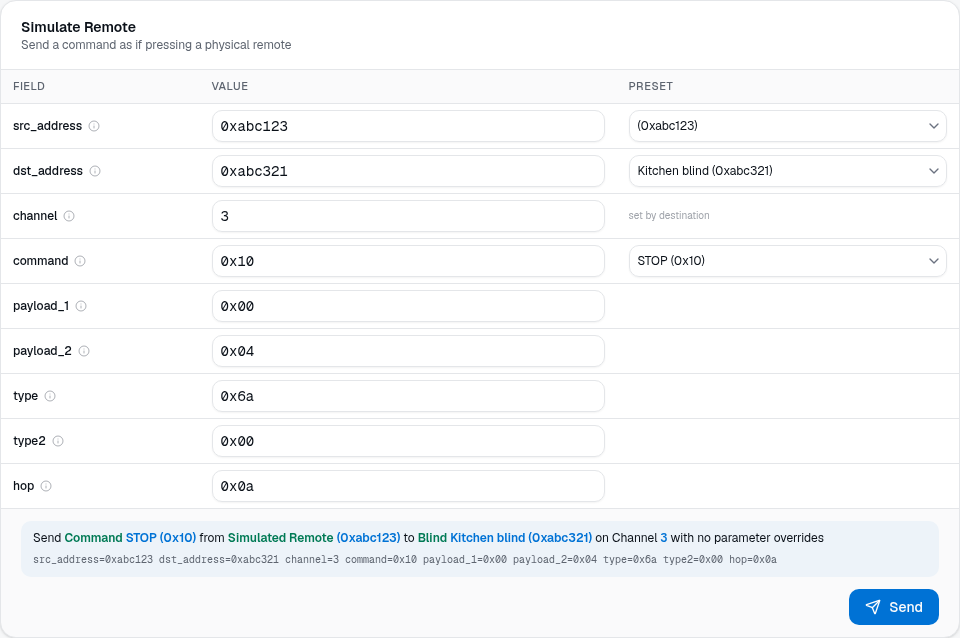

# esphome-elero

Control Elero blinds and lights from Home Assistant through an ESP32 running ESPHome.

- **Radio drivers** — TI CC1101 (stable), Semtech SX1262 and SX1276/77/78 (experimental). [Radio support](docs/CONFIGURATION.md#hub-elero)
- **Home Assistant** — Connect directly through the ESPHome native API or use MQTT discovery.
- **Controls** — Open, close, stop, or tilt blinds. Switch or dim compatible lights, control groups, and receive status updates.
- **Web interface** — Discover blinds from a remote button press, pair the gateway as a remote, and back up your devices.

## Quick start

### 1. Choose a board

We recommend the **Heltec WiFi LoRa 32 V3 or V4**, about US$30. Choose the **863–870 MHz** version. The LILYGO T-Embed CC1101 and T-Embed CC1101 Plus also work at 868 MHz.

| Board | Starter file | Hardware details |
|---|---|---|
| Heltec WiFi LoRa 32 V3 | [V3 YAML](configs/quickstart/heltec-v3.yaml) | [Heltec V3 band selector](https://heltec.org/project/wifi-lora-32-v3) |
| Heltec WiFi LoRa 32 V4 | [V4 YAML](configs/quickstart/heltec-v4.yaml) | V4.2 uses `fem_pa_pin: GPIO46`. V4.3.1 and later use `GPIO5` (untested). [Revision guide](docs/devices/heltec-lora-v4.md#hardware-variants) · [Heltec V4 band selector](https://heltec.org/project/wifi-lora-32-v4) |
| LILYGO T-Embed CC1101 or CC1101 Plus | [LILYGO YAML](configs/quickstart/lilygo-t-embed-cc1101.yaml) | Check for **CC1101** in the model name. [Base model](https://lilygo.cc/en-us/products/t-embed-cc1101) · [Plus model](https://lilygo.cc/products/t-embed-cc1101-plus) |

**Avoid 433 MHz CC1101 boards.** They have poor range with 868 MHz Elero equipment.

### 2. Configure ESPHome

Use ESPHome **2026.10.2 or newer**. Copy your starter file to the ESPHome configuration folder as `elero-gateway.yaml`. Set `wifi_ssid` and `wifi_password` in `secrets.yaml` in the same folder. [ESPHome setup guide](https://esphome.io/install/getting-started/)

- **Native API (default).** Home Assistant connects directly. Restart the gateway once after adding, renaming, or removing blinds. Add `elero_api_key: "your generated key"` to `secrets.yaml`. [Generate an encryption key](https://esphome.io/components/api/#configuration-variables)
- **MQTT.** You need an MQTT broker (message server). Home Assistant shows each saved blind immediately. Expand the settings below to use MQTT.

<details>
<summary><strong>Use MQTT with an existing broker</strong></summary>

Connect the Home Assistant MQTT integration to your broker and enable discovery. In `elero-gateway.yaml`, replace everything below `# Home Assistant connection` with this block. [Home Assistant MQTT discovery options](https://www.home-assistant.io/integrations/mqtt/#discovery-options)

```yaml
mqtt:
  broker: !secret mqtt_broker
  username: !secret mqtt_username
  password: !secret mqtt_password

elero_mqtt:
```

For MQTT, add these entries to `secrets.yaml` and use your broker details.

```yaml
mqtt_broker: "192.168.1.10"
mqtt_username: "Your MQTT username"
mqtt_password: "Your MQTT password"
```

</details>

### 3. Install the firmware

1. Attach the 868 MHz antenna if your board uses an external antenna. Connect the board to your computer with a USB-C data cable.
2. In ESPHome Device Builder, select **Install → Plug into this computer**. From the command line, use `esphome run elero-gateway.yaml` and select the USB port.
3. Open `http://elero-gateway.local/elero`. If needed, replace `elero-gateway.local` with the IP address from the ESPHome log.

### 4. Add your blind and test it

1. Open **Manage**. On your handheld remote, select one blind and press **Stop** once.
2. Click the name in the new **Cover** row. Enter a name, press **Enter**, and click the disk icon (**Save to NVS**). The gateway can now use that remote's address and channel. Repeat for each blind.

   

3. In Home Assistant, open **Settings → Devices & services**.
   - **Native API.** Select **Reboot now** on the gateway after your last save. In Home Assistant, add the ESPHome gateway and enter your encryption key. [ESPHome integration setup](https://www.home-assistant.io/integrations/esphome/#configuration)
   - **MQTT.** Open the **MQTT** integration to find your saved blind.

   

4. Select **Open**, then **Stop**, and check that the blind responds.

## Advanced

### Pair the gateway without a handheld remote

Open **Hub → Learn-In**. The gateway acts as a virtual remote. You need access to a compatible receiver to put it into programming mode.

1. Keep the default **Virtual Remote Address** and select a **Channel** for this blind. Write down both values.
2. Put only the target receiver into programming mode. For a ProLine 2 receiver with no stored transmitter, switch its power off and on. If a transmitter is already stored, follow the instructions for your receiver. [Elero programming guide, page 2](https://www.elero.com/en/downloads-service/downloads?tx_avelero_downloads%5Baction%5D=download&tx_avelero_downloads%5Bcontroller%5D=Download&tx_avelero_downloads%5Bdownload%5D=1298&cHash=72809734d88e40d8f3fda759204ee1f3#page=2)
3. Select **Start learn-in**. Watch the blind. Select **Confirm UP movement** as soon as it starts to move up. Select **Confirm DOWN movement** as soon as it starts to move down. The blind should stop.

   

4. **Complete** means the gateway sent the sequence. Save the blind on the gateway, then test **Open** and **Stop** in Home Assistant. [What learn-in completion means](docs/research/elero-open-protocol-issues.md#what-completion-actually-means-today)

<details>
<summary>Save the blind after direct pairing</summary>

If **Manage** shows the blind with the correct remote address and channel, name it and select **Save to NVS**. If it has no row, use **Hub → RF Packets** to find the source address of a status message from that motor. You need the motor address as well as the virtual remote address to save the blind.

1. Under **Hub → Backup & Restore**, select **Download backup**. Open a copy of the JSON file in a text editor.
2. Add a cover entry to the `devices` list. In the example below, replace `dst_address` with the motor address. Set `src_address` and `channel` to the values from **Learn-In**.

   ```json
   {
     "device_type": "cover",
     "name": "Kitchen blind",
     "dst_address": "0xabc321",
     "src_address": "0x000001",
     "channel": 1,
     "enabled": true
   }
   ```

3. Select **Restore from backup** and choose the edited file. Open **Manage** and check the blind name and channel. [Backup file format](docs/BACKUP-RESTORE.md#snapshot-file-format)

</details>

### Send other remote commands

Open **Hub → Simulate Remote**. Select the remote, blind, and command.

<details>
<summary>See a Stop command in Simulate Remote</summary>



</details>

## After setup

- If the gateway receives no packets, check the antenna, board revision, and frequency. [Radio frequency settings](docs/CONFIGURATION.md#frequency-variants)
- Save a copy of your device list under **Hub → Backup & Restore**. [Backup and restore](docs/BACKUP-RESTORE.md)
- Set opening and closing times for percentage control, or configure tilt and step receivers. [Cover settings](docs/CONFIGURATION.md#cover-position-and-tilt) · [Step receiver guide](docs/TESTING_STEP_RECEIVERS.md)
- Set up other boards, including an ESP32 with a separate CC1101 or a LILYGO LoRa32 V2.1 with an SX1276. [Board guides](docs/devices/)
- Find a remote manual or move devices from an older YAML configuration. [Remote manuals](docs/manuals/) · [Migration guide](docs/MIGRATION-yaml-to-nvs.md)
- Check command bytes, cover groups, and radio limits. [Configuration reference](docs/CONFIGURATION.md) · [Radio framing and limits](docs/RADIO_FRAMING.md#supported-group-size)

<details>
<summary>For contributors</summary>

Local development uses Python 3.12. Run `mise install` and `mise exec -- uv sync` in the repository. The component includes the web interface. If you change the frontend, rebuild and commit `components/elero_web/elero_web_ui.h` with its source. [Build and compatibility guide](docs/ESPHOME-COMPATIBILITY.md#local-verification)

To run the simulator, open two terminals in `components/elero_web/frontend/app`. Run `mise exec node pnpm -- pnpm mock` in one and `mise exec node pnpm -- pnpm dev` in the other. Open `http://localhost:3000`. Enter `{"address":"0x333238","action":"up"}` in the simulator terminal to simulate a remote button press. The simulator keeps saved devices until you stop its process.

</details>

## Credits

This project uses protocol research from [QuadCorei8085/elero_protocol](https://github.com/QuadCorei8085/elero_protocol) (MIT), [stanleypa/eleropy](https://github.com/stanleypa/eleropy) (GPLv3), and [andyboeh/esphome-elero](https://github.com/andyboeh/esphome-elero).
